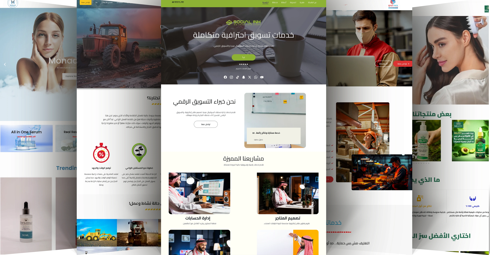
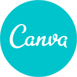

<!-- ═══════════════════════════════════════════════════════ -->
<!--           GITHUB PROFILE README - Gaber Rashwan        -->
<!-- ═══════════════════════════════════════════════════════ -->

<!-- HEADER ANIMATED WAVE -->
<div align="center">
  
</div>

<!-- TYPING ANIMATION -->
<div align="center">
  <a href="https://git.io/typing-svg">
    
  </a>
</div>

<br/>

<!-- ANIMATED BADGES -->
<div align="center">


&nbsp;

&nbsp;

&nbsp;


</div>

<br/>

<div align="center">
  
  &nbsp;
  
</div>

<br/>


## 🧑‍💻 About Me

```typescript
const GaberRashwan = {
  name: "Gaber Rashwan",
  location: "Alexandria, Egypt 🇪🇬",
  experience: "7+ years",
  roles: [
    "Full Stack Developer",
    "UI/UX Designer",
    "SEO Specialist",
    "Digital Marketing Expert",
    "CMS Developer",
  ],
  stack: {
    frontend: ["React", "Next.js", "Vue.js", "TypeScript"],
    backend: ["Node.js", "Express", "NestJS", ".NET", "PHP"],
    cms: ["WordPress", "WooCommerce", "Salla", "Zid", "Shopify"],
    design: ["Figma", "Adobe XD", "Photoshop", "Canva"],
    marketing: [
      "SEO",
      "Google Ads",
      "Meta Ads",
      "Media Buying",
      "Social Media",
    ],
    cloud: ["AWS", "Azure", "GCP", "Docker"],
  },
  passion: "Turning ideas into elegant digital solutions 💡",
  available: true, // ✅ Open to Freelance opportunities!
};
```

<p align="left">
🎯 I'm a <strong>Web Development and Digital Marketing Specialist</strong> from Alexandria, Egypt 🇪🇬 with <strong>7+ years of experience</strong> building scalable web applications, e-commerce platforms, and high-converting digital experiences.<br/><br/>
💡 I specialize in crafting <strong>pixel-perfect UIs</strong> backed by <strong>robust backend systems</strong>, with a deep passion for <strong>SEO optimization</strong> and <strong>digital marketing strategies</strong> that drive real business results.<br/><br/>
🚀 Whether you need a <strong>full-featured web app</strong>, a <strong>custom WordPress solution</strong>, or a <strong>complete digital marketing strategy</strong> — I've got you covered.
</p>

<br/>

<div align="center">
  <a href="https://www.behance.net/GaberRashwan" target="_blank">
    
  </a>
  <br/>
  <sub><i>✨ Click to explore my full portfolio on Behance →</i></sub>
</div>


## 💼 Services I Offer

<div align="center">

|    🌐 Web Development    |     🎨 UI/UX Design      |  📈 Digital Marketing   |
| :----------------------: | :----------------------: | :---------------------: |
|   Full Stack Web Apps    |   Website & App Design   |  SEO Strategy & Audit   |
| WordPress · WooCommerce  |     Figma / Adobe XD     |  Google Ads Campaigns   |
|  Shopify · Salla · Zid   |    Responsive Design     | Meta Ads & Media Buying |
|   REST API Development   |   Brand Identity & UI    | Social Media Marketing  |
| Performance Optimization | Prototyping & Wireframes |  Analytics & Reporting  |

</div>


## 🚀 Featured Projects

<div align="center">

| Project                    | Description                                         | Tech Stack                  |            Links            |
| -------------------------- | --------------------------------------------------- | --------------------------- | :-------------------------: |
| 🛒 **E-Commerce Platform** | Full-featured online store with payment integration | React · Node.js · MongoDB   | [🔗 Demo](#) · [💻 Code](#) |
| 🌐 **Corporate Website**   | Multi-language business website with CMS            | Next.js · WordPress · MySQL | [🔗 Demo](#) · [💻 Code](#) |
| 📊 **Marketing Dashboard** | Real-time analytics & campaign tracking             | React · .NET · PostgreSQL   | [🔗 Demo](#) · [💻 Code](#) |

</div>


## 🛠️ Tech Stack

### 💻 Programming Languages

<div align="left">
  &nbsp;&nbsp;&nbsp;&nbsp;&nbsp;&nbsp;&nbsp;
</div>

### 🧩 Frameworks & Libraries

<div align="left">
  &nbsp;&nbsp;&nbsp;&nbsp;&nbsp;&nbsp;&nbsp;
  <br/><br/>
  &nbsp;&nbsp;&nbsp;&nbsp;&nbsp;&nbsp;&nbsp;
</div>

### 🎨 UI/UX Design Tools

<div align="left">
  &nbsp;&nbsp;&nbsp;&nbsp;
</div>

### ⚙️ Tools & DevOps

<div align="left">
  &nbsp;&nbsp;&nbsp;&nbsp;&nbsp;&nbsp;&nbsp;
  <br/><br/>
  &nbsp;&nbsp;&nbsp;&nbsp;&nbsp;&nbsp;
</div>


## 🌱 What I'm Currently Working On

```
🔭  Building     →  Scalable E-Commerce platform with Next.js & Node.js
🌱  Learning     →  Advanced SEO Automation & AI-powered Marketing Tools
📖  Reading      →  System Design principles & Cloud Architecture patterns
🎯  Goal 2026    →  Launch my own SaaS product for digital agencies
```


## 📊 GitHub Statistics

<div align="center">
  
  
</div>

<div align="center">
  
</div>


## 🏆 GitHub Trophies

<div align="center">
  
</div>


## 📈 Contribution Activity

<div align="center">
  
</div>


## 🐍 Contribution Snake

<div align="center">
  
</div>


## ⚡ Fun Facts

```yaml
☕  Coffee consumed daily: "Way too much to count"
🐛  Most common bug fix: "It was a missing semicolon... again"
🎵  Codes better with: "Lo-fi hip hop beats"
🌙  Favorite work hours: "Late nights = peak productivity"
🎯  Life motto: "Ship it, then improve it"
```


## 💬 Random Dev Quote

<div align="center">
  
</div>


## 📲 Connect With Me

<div align="center">

[](https://linktr.ee/MrGaberSamir)
[](https://www.linkedin.com/in/gaberrashwan/)
[](https://www.behance.net/GaberRashwan)
[](https://wa.me/201033764441)
[](https://stackoverflow.com/users/31779345/)
[](https://www.facebook.com/Eng.Gaber.Samir)

</div>

<br/>

<div align="center">
  <i>📩 I'm always open to new opportunities, collaborations, and challenging projects where I can contribute, learn, and create meaningful impact.</i>
</div>

<br/>

<!-- FOOTER WAVE -->
<div align="center">
  
</div>
#
