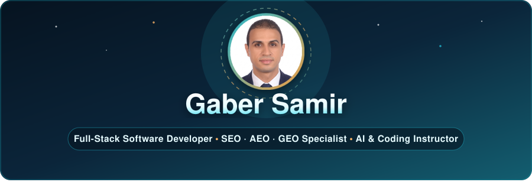
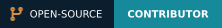
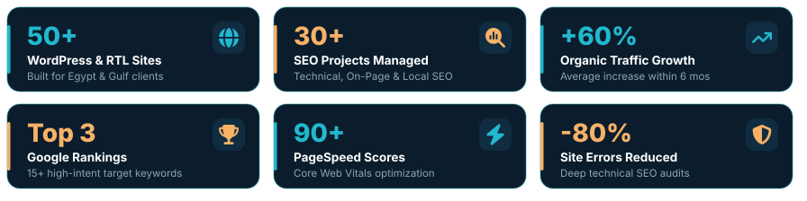
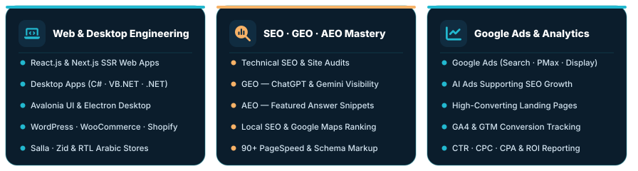
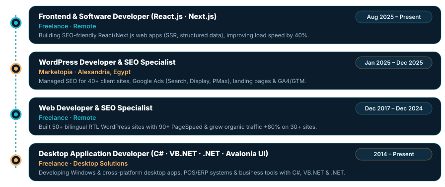
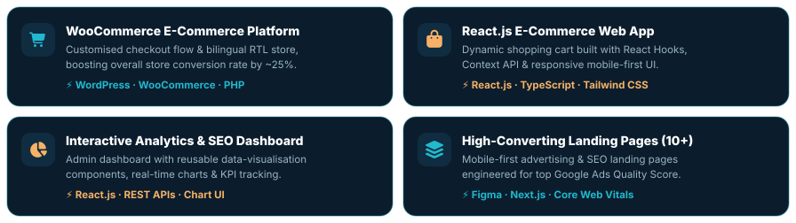
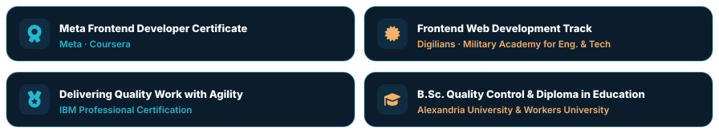
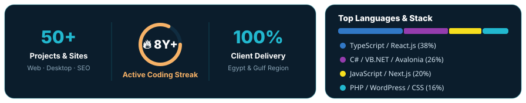
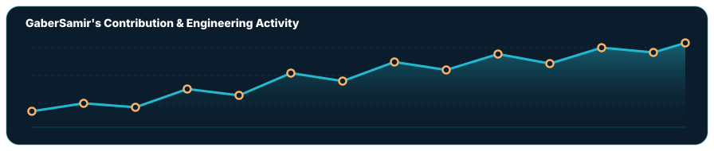
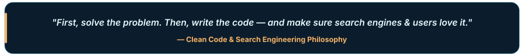

<!-- ═══════════════════════════════════════════════════════ -->
<!--            GITHUB PROFILE README - Gaber Samir          -->
<!-- ═══════════════════════════════════════════════════════ -->

<!-- HERO BANNER WITH CENTERED PROFILE PHOTO & PORTFOLIO VISUAL IDENTITY -->
<div align="center">
  <a href="https://gabersamir.com" target="_blank" rel="noopener noreferrer">
    
  </a>
</div>

<!-- LOCAL TYPING ANIMATION -->
<div align="center">
  
</div>

<br/>

<!-- ANIMATED BADGES (FontAwesome 7.3.0) -->
<div align="center">


&nbsp;

&nbsp;

&nbsp;


</div>

<br/>


##  About Me

```typescript
const GaberSamir = {
  name: "Gaber Samir",
  location: "Alexandria, Egypt 🇪🇬",
  experience: "8+ years",
  roles: [
    "Full Stack Developer",
    "Desktop App Developer",
    "UI/UX Designer",
    "SEO / GEO / AEO Specialist",
    "CMS Developer",
    "Programming & AI Instructor",
  ],
  stack: {
    frontend: ["React", "Next.js", "Vue.js", "TypeScript"],
    backend: ["Node.js", "Express", "NestJS", ".NET", "PHP"],
    desktop: ["C#", "VB.NET", ".NET", "Avalonia UI", "Electron"],
    cms: ["WordPress", "WooCommerce", "Salla", "Zid", "Shopify"],
    design: ["Figma", "Adobe XD", "Photoshop", "Canva"],
    search: [
      "SEO",
      "GEO (Generative Engine Optimization)",
      "AEO (Answer Engine Optimization)",
    ],
    ads: ["Google Ads", "AI Ads"], // 📈 Supporting & amplifying SEO growth
    cloud: ["AWS", "Azure", "GCP", "Docker"],
    ai: ["Cursor", "Antigravity", "Trae", "Devin", "Claude AI", "GitHub Copilot", "ChatGPT"],
  },
  passion: "Turning ideas into elegant digital solutions 💡",
  available: true, // ✅ Open to Freelance opportunities!
};
```

<br/>

<div align="center">
  <a href="https://www.behance.net/GaberSamir" target="_blank" rel="noopener noreferrer">
    
  </a>
  <br/>
  <sub><i>✨ Click to explore my portfolio on Behance → &nbsp;|&nbsp; Case studies at <a href="https://gabersamir.com" target="_blank" rel="noopener noreferrer">gabersamir.com</a></i></sub>
</div>


##  Impact in Numbers

<div align="center">
  
</div>


##  Services I Offer

<div align="center">
  
</div>


##  Tech Stack

###  Programming Languages

<div align="left">
  &nbsp;&nbsp;&nbsp;&nbsp;&nbsp;&nbsp;&nbsp;&nbsp;
</div>

###  Frontend & Web Frameworks

<div align="left">
  &nbsp;&nbsp;&nbsp;&nbsp;&nbsp;&nbsp;&nbsp;&nbsp;&nbsp;&nbsp;
</div>

###  Desktop & Backend Frameworks

<div align="left">
  &nbsp;&nbsp;&nbsp;&nbsp;&nbsp;
</div>

###  CMS & E-Commerce Platforms

<div align="left">
  &nbsp;&nbsp;&nbsp;&nbsp;&nbsp;
</div>

###  UI/UX Design Tools

<div align="left">
  &nbsp;&nbsp;&nbsp;&nbsp;
</div>

###  DevOps, Cloud & Databases

<div align="left">
  &nbsp;&nbsp;&nbsp;&nbsp;&nbsp;&nbsp;
  <br/><br/>
  &nbsp;&nbsp;&nbsp;&nbsp;&nbsp;&nbsp;
</div>

###  SEO, Ads & Analytics

<div align="left">
  &nbsp;&nbsp;&nbsp;&nbsp;&nbsp;&nbsp;&nbsp;&nbsp;&nbsp;
</div>

###  AI Tools & Agents

<div align="left">
  &nbsp;&nbsp;&nbsp;&nbsp;&nbsp;&nbsp;
</div>


##  Experience

<div align="center">
  
</div>


##  Featured Projects

<div align="center">
  
</div>

###  Live Client Websites

<div align="center">
  <a href="https://zaytunateerace.com" target="_blank" rel="noopener noreferrer"></a>&nbsp;<a href="https://babalanbrya.com" target="_blank" rel="noopener noreferrer"></a>&nbsp;<a href="https://kababfayrouz.com" target="_blank" rel="noopener noreferrer"></a>&nbsp;<a href="https://bsbrother.com" target="_blank" rel="noopener noreferrer"></a>&nbsp;<a href="https://mammamiasa.com" target="_blank" rel="noopener noreferrer"></a>&nbsp;<a href="https://woktimesa.com" target="_blank" rel="noopener noreferrer"></a>
  <br/><br/>
  <sub><i>✨ Live restaurant websites built and maintained — explore full case studies at <a href="https://gabersamir.com" target="_blank" rel="noopener noreferrer">gabersamir.com</a></i></sub>
</div>


##  Certifications & Education

<div align="center">
  
</div>


##  What I'm Currently Working On

```
🔭  Building     →  Web apps (React.js · Next.js) & Cross-Platform Desktop apps (C# · VB.NET · .NET · Avalonia UI)
🌱  Learning     →  GEO & AEO strategies for AI search engines
📖  Reading      →  System Design principles & Cloud Architecture patterns
🎯  Goal 2026    →  Launch my own SaaS product for digital agencies
```


##  GitHub Statistics

<div align="center">
  
</div>


##  Contribution Activity

<div align="center">
  
</div>


## 🐍 Contribution Snake

<div align="center">
  
</div>


##  Fun Facts

```yaml
☕  Coffee consumed daily: "Way too much to count"
🐛  Most common bug fix: "It was a missing semicolon... again"
🎵  Codes better with: "Lo-fi hip hop beats"
🌙  Favorite work hours: "Late nights = peak productivity"
🎯  Life motto: "Ship it, then improve it"
```


##  Engineering Philosophy

<div align="center">
  
</div>


##  Connect With Me

<div align="center">
  <a href="https://gabersamir.com" target="_blank" rel="noopener noreferrer" title="Website: GaberSamir.com"></a>&nbsp;<a href="mailto:Gabersamir95@gmail.com" target="_blank" rel="noopener noreferrer" title="Email: Gabersamir95@gmail.com"></a>&nbsp;<a href="https://www.linkedin.com/in/gabersamir" target="_blank" rel="noopener noreferrer" title="LinkedIn: Gaber Samir"></a>&nbsp;<a href="https://github.com/Gabersamir" target="_blank" rel="noopener noreferrer" title="GitHub: GaberSamir"></a>&nbsp;<a href="https://www.behance.net/GaberSamir" target="_blank" rel="noopener noreferrer" title="Behance: GaberSamir"></a>&nbsp;<a href="https://wa.me/201033764441" target="_blank" rel="noopener noreferrer" title="WhatsApp Business"></a>&nbsp;<a href="https://www.facebook.com/GaberSamirOfficial" target="_blank" rel="noopener noreferrer" title="Facebook: GaberSamirOfficial"></a>&nbsp;<a href="https://www.instagram.com/GaberSamirOfficial" target="_blank" rel="noopener noreferrer" title="Instagram: GaberSamirOfficial"></a>&nbsp;<a href="https://www.threads.net/@GaberSamirOfficial" target="_blank" rel="noopener noreferrer" title="Threads: GaberSamirOfficial"></a>&nbsp;<a href="https://www.youtube.com/@GaberSamirOfficial" target="_blank" rel="noopener noreferrer" title="YouTube: GaberSamirOfficial"></a>&nbsp;<a href="https://www.tiktok.com/@GaberSamirOfficial" target="_blank" rel="noopener noreferrer" title="TikTok: GaberSamirOfficial"></a>&nbsp;<a href="https://x.com/GaberSamir" target="_blank" rel="noopener noreferrer" title="X (Twitter): Gaber Samir"></a>
</div>

<br/>

<div align="center">
  <i>📩 I'm always open to new opportunities, collaborations, and challenging projects where I can contribute, learn, and create meaningful impact.</i>
</div>

<br/>

<!-- LOCAL FOOTER WAVE -->
<div align="center">
  
</div>
